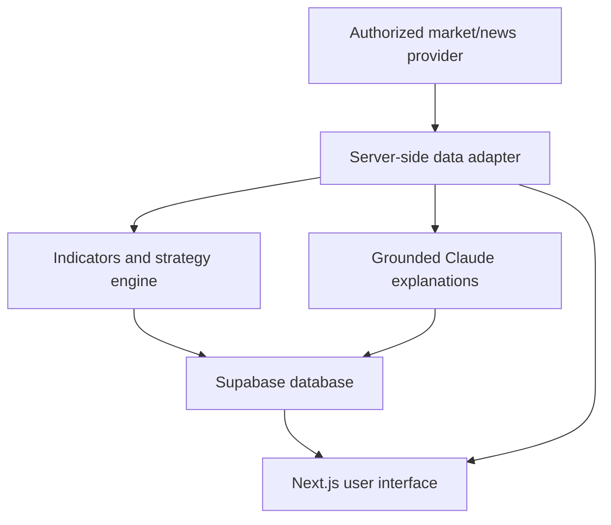

# MarketLens AI — Statement of Work (SOW)

**Project:** Indian Stock Market Intelligence & Paper Trading Web Application  
**Version:** 1.0 — Implementation specification  
**Status:** Draft for development  
**Target platform:** Responsive web application  
**Primary build tool:** Claude Code  
**Delivery approach:** Incremental, test-driven MVP

## 1. Project objective

Build a production-structured, portfolio-ready web application that helps users explore Indian equities through authorized market data, explainable AI research, news analysis, rule-based strategy backtesting, and virtual trading.

**Primary outcome:** A working, deployed demonstration that showcases full-stack engineering, financial data integration, data processing, LLM integration, and secure user accounts.

**Product boundaries:** The MVP is an information and educational tool. It **must not** place real-money orders, provide personalized investment advice, promise returns, or present generated estimates as live market facts.

## 2. Users and access

| Role | Permissions |
| --- | --- |
| Visitor | Explore the dashboard and selected stock research using licensed data or explicitly labeled demo data; preview one sample backtest. |
| Registered user | All visitor functionality plus saved watchlists, alerts, paper portfolios, and backtest history. |

No admin dashboard, subscription system, or multi-tenant enterprise roles in the MVP.

## 3. Scope: five functional modules

### M1 — Indian market dashboard

**Required**

- Market overview cards for NIFTY 50, SENSEX, and BANK NIFTY, subject to permitted data coverage.
- Searchable list of an initial curated universe of approximately 20 NSE/BSE stocks.
- Price, absolute/percentage change, volume when available, and latest observation time.
- Top gainers/losers **within the tracked universe**; never mislabel these as exchange-wide leaders.
- Interactive historical price chart for a selected stock or index.
- Consistent `LIVE`, `DELAYED`, `CLOSED`, `STALE`, or `DEMO` data-status label, as applicable.
- Empty, loading, unauthorized, and API-error states.

**Optional if provider supports it:** Sector indices, India VIX, FII/DII activity.

**Acceptance:** A user can find a tracked symbol, inspect a chart and quote, and see data origin/freshness; the page remains usable when the provider is unavailable.

### M2 — Explainable AI stock research

**Required**

- Search/select a stock using the data provider's official instrument identifier.
- Fetch authorized OHLCV history and calculate SMA(20), SMA(50), EMA(20), EMA(50), and RSI(14) in deterministic application code.
- Derive transparent descriptive conditions (e.g., price above/below SMA, crossover observed, RSI threshold); do not treat these as guaranteed buy/sell signals.
- Claude-generated concise explanation of observed trend, supporting indicators, uncertainty, and risks, based **only on supplied source data**.
- Show observation time, metrics used, linked sources where available, and an informational-use disclaimer.
- Return `insufficient_data` rather than fabricate indicators or financial figures.

**Optional:** Company profile, financial statements, and corporate actions where API access allows.

**Acceptance:** The analysis references displayed values, never invents price or news facts, and degrades gracefully when the Claude API is unavailable.

### M3 — News and sentiment radar

**Required**

- List authorized market/company news with headline, publisher, timestamp, source URL, and mapped instrument(s).
- Classify each article as `positive`, `negative`, `neutral`, or `unclear` using Claude.
- Display a short, grounded summary and explanation of classification.
- Filter by symbol and sort newest first; deduplicate repeated links.
- Make clear that article sentiment is **not** proof of subsequent price impact.
- If content rights permit headlines only, analyze only those headlines and explicitly indicate limited evidence.

**Acceptance:** Every displayed article has source attribution and a working original link; no invented news is shown as real.

### M4 — Strategy lab and paper trading

**Required**

- Daily-bar, long-only equity backtests for: (a) SMA crossover and (b) RSI threshold strategy.
- Configurable symbol, date range, starting virtual capital, position size, estimated fees, and slippage.
- Calculate signals using information available at bar close and simulate fills **no earlier than the next available bar**, preventing look-ahead bias.
- Show total return, number of trades, win rate when defined, maximum drawdown, equity curve, and trade ledger.
- Compare against a same-period buy-and-hold benchmark, including assumptions.
- Allow registered users to create a paper portfolio and record simulated buy/sell trades only.
- Label backtests and paper accounts `SIMULATED — NOT LIVE TRADING`.
- Show warnings when historical coverage or corporate-action adjustments are insufficient.

**Acceptance:** Unit tests confirm cash, holdings, fees, fill timing, returns, and drawdown; no live broker order endpoint exists in the codebase.

### M5 — Watchlists, alerts, and daily briefing

**Required**

- Signed-in users can add/remove stocks to a private watchlist.
- Create threshold alerts (price greater than / less than value) for tracked stocks.
- Persist triggered alert events, with timestamp and observed value; show them inside the app.
- Generate an on-demand AI watchlist briefing from current available quotes and news metadata.
- State alert-check frequency and data delay; do not promise instant execution or delivery.

**Excluded from MVP:** Email/SMS/push delivery, autonomous agent actions, and unattended trade execution.

**Acceptance:** Watchlists and alerts persist across sessions; one user cannot read or modify another user's records.

## 4. Pages and user journeys

| Route | Screen | Main action |
| --- | --- | --- |
| `/` | Landing / demo entry | Understand product and enter demo. |
| `/dashboard` | Market overview | Inspect indices, tracked movers, and prices. |
| `/stocks/[instrument]` | Stock research | View chart, indicators, and grounded AI analysis. |
| `/news` | News radar | Filter news and review sentiment. |
| `/strategy` | Strategy lab | Run backtests and inspect simulated outcomes. |
| `/watchlist` | Watchlist and alerts | Save instruments, configure alerts, generate briefing. |
| `/auth` | Authentication | Sign up, sign in, sign out. |

**Navigation:** Dashboard, Analyze, News, Strategy Lab, Watchlist.  
**Design direction:** Restrained professional finance UI; dark navy/charcoal surfaces, teal accents, accessible red/green indicators, responsive layouts, readable tables and charts. No decorative fake trading numbers.

## 5. Technical architecture

### Fixed MVP stack

- **Web + server:** Next.js App Router, React, TypeScript.
- **Styling:** Tailwind CSS with a small reusable component library.
- **Charting:** TradingView Lightweight Charts (respect its license/attribution requirements).
- **Database and login:** Supabase PostgreSQL, Supabase Auth, Row Level Security (RLS).
- **Market-data adapter:** Upstox read-only endpoints using a server-side token, where permitted.
- **LLM:** Anthropic Claude API, invoked server-side only.
- **Deployment:** Vercel (or equivalent compatible Next.js host).
- **Validation/tests:** Zod for server input validation; Vitest for deterministic calculations and service tests; UI smoke testing.

**No separate Python backend, Redis, vector database, LangChain, LangGraph, microservices, or live trading SDK for MVP.** Add them only when a demonstrated requirement justifies them.

### Data flow



**Engineering boundaries**

1. `MarketDataProvider` abstracts external APIs and has `UpstoxProvider` and `DemoProvider` implementations.
2. All quote/history/news requests, keys, retries, caching, and rate limits remain server-side.
3. Indicator and backtest calculations are pure, testable functions; the LLM does not calculate performance statistics.
4. The LLM receives structured facts with timestamps and provenance, and outputs a validated schema.
5. If external credentials/data rights are unavailable, the app operates in conspicuously labeled demo mode with synthetic fixtures.

## 6. External integrations

| Integration | MVP usage | Official source |
| --- | --- | --- |
| Upstox Analytics Token | Read-only API authentication, subject to eligibility | https://upstox.com/developer/api-documentation/analytics-token |
| Upstox Full Market Quotes V3 | Quote snapshots | https://upstox.com/developer/api-documentation/get-full-market-quote-v3 |
| Upstox Historical Candles V3 | OHLCV series for charts/indicators/backtests | https://upstox.com/developer/api-documentation/v3/get-historical-candle-data |
| Upstox News API | News metadata where accessible | https://upstox.com/developer/api-documentation/get-news |
| Upstox FII/DII API | Optional macro context | https://upstox.com/developer/api-documentation/get-fii-data |
| Anthropic Claude API | Explanations, sentiment, and briefings | https://platform.claude.com/docs/en/home |
| Supabase | Accounts, RLS, and application records | https://supabase.com/docs |

### Integration rules

- Check each provider's **current** eligibility, API quotas, costs, data freshness, commercial display rights, and redistribution license before using the data in a public deployment.
- Do not scrape NSE/BSE, bypass authentication, or redistribute a broker feed without permission.
- Never expose broker or Claude secrets in `NEXT_PUBLIC_*` variables, browser code, logs, or git history.
- Use explicit `asOf`, `source`, and `status` metadata in the normalized data contract.
- Backfill historical data only to the extent permitted by API plans and licensing.
- Demo data must be deterministic and visibly marked `DEMO`; never blend it silently with live data.

### Required environment variables

```dotenv
UPSTOX_ANALYTICS_TOKEN=
ANTHROPIC_API_KEY=
NEXT_PUBLIC_SUPABASE_URL=
NEXT_PUBLIC_SUPABASE_ANON_KEY=
SUPABASE_SERVICE_ROLE_KEY=
```

Add `.env.example` with empty placeholders; place real credentials in ignored `.env.local` or host secret settings. `SUPABASE_SERVICE_ROLE_KEY` is server-only; enforce RLS for user-facing access.

## 7. Internal API and data contracts

Implement only these initial routes; exact query parameters may be refined when coding:

| Endpoint | Method | Response/operation |
| --- | --- | --- |
| `/api/market/overview` | GET | Index snapshots, tracked movers, freshness metadata. |
| `/api/instruments/search?q=` | GET | Authorized instrument search results and stable provider keys. |
| `/api/stocks/[key]/history` | GET | Timestamped OHLCV candle array, interval and source. |
| `/api/stocks/[key]/analysis` | GET | Deterministic indicators and optional grounded AI explanation. |
| `/api/news?instrument=` | GET | Attributed articles, sentiment, pagination if supported. |
| `/api/backtests` | POST | Validated parameters, performance metrics, equity curve, trades, warnings. |
| `/api/watchlists` | GET/POST | Current user's saved watchlists. |
| `/api/alerts` | GET/POST/PATCH | Current user's saved conditions and events. |

**Canonical types**

- `Instrument`: `instrumentKey`, `symbol`, `exchange`, `name`, `currency`.
- `Quote`: `instrumentKey`, `lastPrice`, `change`, `changePercent`, `volume?`, `asOf`, `source`, `status`.
- `Candle`: `timestamp`, `open`, `high`, `low`, `close`, `volume`.
- `NewsItem`: `id`, `title`, `publisher`, `publishedAt`, `sourceUrl`, `instrumentKeys[]`, `sentiment`, `summary?`.
- `StockAnalysis`: `instrumentKey`, `asOf`, `indicators`, `observations[]`, `risks[]`, `sources[]`, `dataQualityWarnings[]`.
- `BacktestResult`: `parameters`, `trades[]`, `equityCurve[]`, `metrics`, `benchmark`, `warnings[]`.

Money is denominated in INR for Indian equities. Use decimal-safe handling for monetary accounting; do not rely on unrounded JavaScript floating-point sums for persisted cash balances.

## 8. Database schema (logical)

Supabase Auth owns credential and session tables. Application tables:

| Table | Key fields |
| --- | --- |
| `profiles` | `user_id` (UUID PK), `created_at` |
| `instruments` | `instrument_key` (PK), `symbol`, `exchange`, `name`, `updated_at` |
| `watchlists` | `id`, `user_id`, `name`, `created_at` |
| `watchlist_items` | `id`, `watchlist_id`, `instrument_key`, `created_at`; unique `(watchlist_id, instrument_key)` |
| `alerts` | `id`, `user_id`, `instrument_key`, `operator`, `threshold`, `enabled`, `last_triggered_at` |
| `alert_events` | `id`, `alert_id`, `observed_value`, `observed_at`, `created_at` |
| `paper_portfolios` | `id`, `user_id`, `name`, `starting_cash`, `cash_balance`, `created_at` |
| `paper_trades` | `id`, `portfolio_id`, `instrument_key`, `side`, `quantity`, `fill_price`, `fees`, `filled_at` |
| `backtest_runs` | `id`, `user_id`, `instrument_key`, `strategy`, `parameters_json`, `metrics_json`, `created_at` |

**Constraints:** Foreign keys, uniqueness, nonnegative quantities/cash where applicable, valid sides/operators, indexes on user and instrument lookup fields. RLS protects every user-owned table, including indirect access through child tables. Do not store full copyrighted articles without permission.

## 9. AI behavior and guardrails

### Stock research output

Send Claude only verified normalized quote, candle-derived metrics, optional available fundamentals, and cited news metadata. Require structured output:

```json
{
  "summary": "string",
  "observations": ["string"],
  "risks": ["string"],
  "uncertainties": ["string"],
  "sources": [{"label": "string", "url": "string"}],
  "asOf": "ISO-8601 timestamp"
}
```

### Mandatory AI rules

- State what the supplied data supports, what it does not support, and when it was observed.
- Never manufacture numbers, articles, citations, corporate events, or certainty.
- If input is stale or incomplete, say so and reduce claim strength.
- Do not output personalized position sizing or autonomous trade instructions.
- All machine-readable responses must pass server-side schema validation.
- Cache repeated explanations where permissible; apply user/API rate limits to control costs.

## 10. Security, reliability, and UX requirements

- Authentication required for persistent personal data; visitor demo works without login.
- Supabase RLS and server-side authorization on every user-owned resource.
- Server-side API keys, input validation, request rate limiting, bounded API retries, and safe errors.
- Show markets-closed, stale data, missing credentials, AI unavailable, and insufficient candles states.
- Mobile-first responsive layout; keyboard-accessible navigation and sufficient color contrast.
- Do not rely only on green/red color to convey gains/losses; show signed numbers.
- Log errors without leaking API tokens, email addresses, or private payloads.
- Unit tests for indicators, backtesting, accounting, and user-level authorization checks.
- Build, lint, and test commands must pass before handoff.

## 11. Delivery phases and acceptance gates

| Phase | Deliverables | Gate to proceed |
| --- | --- | --- |
| **P1 — Foundation** | Next.js app, pages/routes, design system, demo data adapter, README | Every page renders; working navigation; clear `DEMO` badges; mobile layout. |
| **P2 — Data** | Upstox adapter, quotes, search, candles, freshness/caching | Correct normalized response from an authorized API; no client secret exposure; graceful fallback. |
| **P3 — Intelligence** | Indicators, grounded Claude stock research, news sentiment | Indicator unit tests pass; citations/freshness visible; hallucination-safe unavailable states. |
| **P4 — Simulation** | Two backtest strategies, equity curve, paper portfolio | Timing, accounting, fee, and drawdown tests pass; no real order calls. |
| **P5 — User release** | Auth, RLS, watchlists, threshold alerts, deployment, documentation | Two-account isolation test; full build/test pass; deployed demo operates without private broker credentials. |

### Project-level definition of done

1. All five scoped modules work end-to-end or show a truthful, usable fallback state.
2. No misleading live-data labels, fabricated financial facts, fake performance, or real-money order capabilities.
3. All user data is access-controlled; secrets are absent from client bundles and repository.
4. Deterministic indicators/backtests have passing unit tests, including edge cases.
5. Deployment, local setup, provider configuration, and known limitations are documented.
6. A reviewer can use demo mode without paying or supplying private API credentials.

## 12. Explicit exclusions and future backlog

**Out of scope for MVP:** Actual order placement, autonomous agents making investments, options/futures strategies, brokerage account portfolio sync, guaranteed price predictions, subscription billing, payment collection, paid stock tips, email/SMS/push notifications, unrestricted exchange-wide screeners, multilingual support, and mobile native apps.

**Potential Phase 2:** Sector comparison, India VIX and FII/DII context, corporate actions, paper portfolio risk analytics, Telugu explanations, licensed advanced market feeds, and user-configurable scheduled briefings.

**Regulatory/deployment checkpoint:** Before adding public investment recommendations or automated orders, independently review the applicable SEBI, broker, exchange, research/advisory, and data-licensing requirements. Relevant starting point: https://www.sebi.gov.in/legal/circulars/feb-2025/safer-participation-of-retail-investors-in-algorithmic-trading_91614.html

## 13. Assumptions and dependencies

- Developer has a working Node.js/Claude Code environment and can obtain a Supabase project.
- Authorized market-data access may require an eligible brokerage/developer account; coverage and commercial display rights are not assumed.
- Claude API costs and model availability depend on the developer's account and current pricing.
- Index coverage, article rights, and historical depth must be verified during P2 rather than hardcoded as guarantees.
- If live provider integration is blocked by access/permission/licensing, continue with transparent demo mode and record the blocker. Do not circumvent restrictions.
- Any additional requirements must be reviewed for scope, data/legal dependencies, and impact on delivery phases before implementation.

## 14. How to execute this SOW in Claude Code

Place this file at your project root as `MarketLens_AI_SOW.md`. Start Claude Code in that folder and paste:

```text
Read @MarketLens_AI_SOW.md completely and treat it as the source of truth.
I am the developer. Implement only Phase P1 (Foundation) now.
Use the exact MVP stack and scope. Create a maintainable project structure,
responsive UI, all required pages, a typed DemoProvider, README, and tests.
Do not connect real trading APIs or add out-of-scope features.
Do not invent financial facts; label every fixture as DEMO.
After making changes, run the available build/lint/test checks.
Report: files changed, commands executed, verification results,
remaining issues, and the precise next step for P2. Ask me before
spending API credits, accessing protected credentials, or deploying.
```
